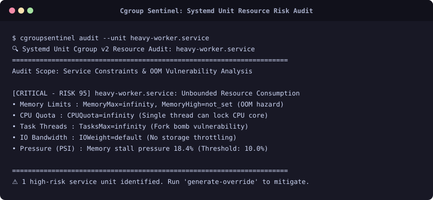
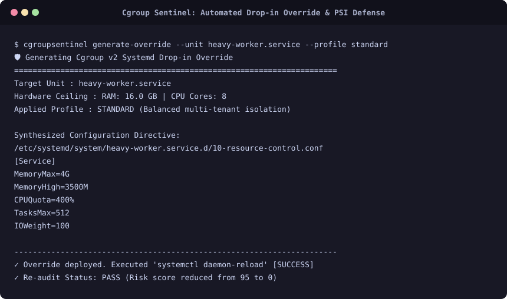

# Cgroup Resource Sentinel

A zero-dependency Python project for inspecting Linux cgroup v2 resources, auditing systemd service unit limits, and generating hardened resource-governance drop-in overrides to prevent out-of-memory (OOM) lockups and CPU starvation.

## Visual Walkthrough & Execution Previews

### 1. Systemd Unit Cgroup Resource Risk Audit


### 2. Automated Drop-in Override & PSI Defense


## What’s included

- Inspect cgroup v2 unified hierarchy, process slice assignments, and Linux Pressure Stall Information (PSI).
- Audit systemd service unit files and evaluate OOM hazard risk scores.
- Generate and deploy drop-in overrides with conservative, standard, and aggressive governance profiles.
- Preview generated configuration by default; `--apply` safely writes drop-in files to `/etc/systemd/system/*.service.d/`.

## Getting started

From the repository root, use Python 3.9 or later (standard library only, zero pip dependencies):

```sh
python3 -m cgroupsentinel --help
python3 -m cgroupsentinel report
python3 -m cgroupsentinel pressure
```

To review a proposed drop-in without writing it:

```sh
python3 -m cgroupsentinel generate-override example.service --profile standard
```

The CLI also provides `audit`, `inspect`, and JSON output for supported commands. Use each subcommand’s `--help` for options. Applying an override changes systemd configuration and may affect a service; review the generated file, destination and rollback plan first. Applying a file does not itself establish that it is appropriate for the workload.

## Scope

Cgroup and systemd behavior depend on the host and its configuration. Limits can affect workloads and do not guarantee a stable desktop or prevent every out-of-memory event. Verify the generated settings and observe the workload on the target machine.

## Tests & CI Verification

The repository includes a comprehensive unit test suite in [tests/](tests/):

```sh
python3 -m unittest discover -s tests -v
```

All 23 test cases run across Python 3.9 through 3.13 on Ubuntu and macOS in GitHub Actions CI (`.github/workflows/ci.yml`).

## Engineering Standards & Magi Bible 📖

All code, documentation, and operational protocols follow the open-source **Magi AI Engineering Standard**:
- **[MAGI_LOOK_HERE.md](MAGI_LOOK_HERE.md):** Contributor & autonomous agent operational rules, code of conduct, and verification criteria.
- **[MAGI_BIBLE.md](MAGI_BIBLE.md):** The Universal Magi Bible establishing Rule 16 commentary ($\ge 25\%$), visual walkthrough previews, fail-closed boundaries, and standard library reliance.

## License

[MIT](LICENSE)
